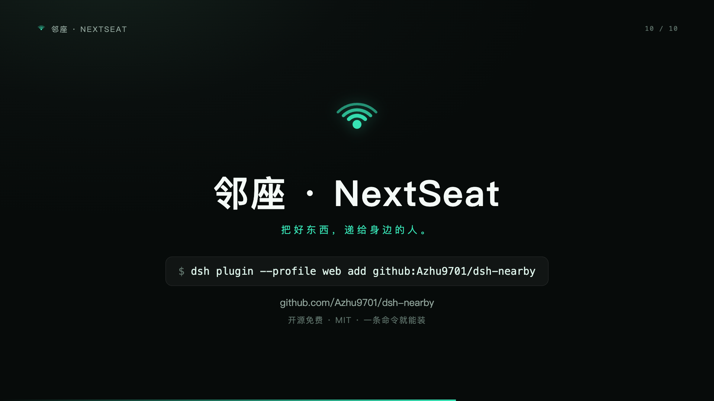
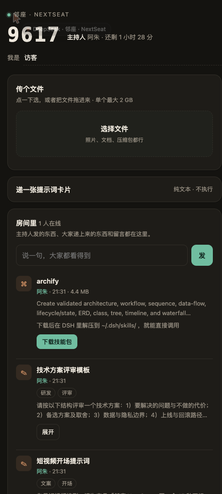
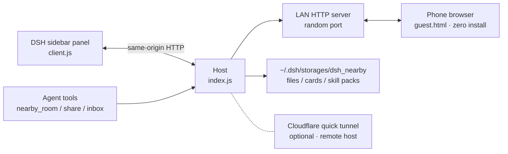

<div align="center">


# NextSeat · 邻座

**A face-to-face sharing space for DSH.** Open a room, hand over the QR code — the files, prompt cards and skill packs you just made in DSH go straight to everyone in the room.

[](LICENSE)
[](https://github.com/awesome-dsh-plugin/awesome-dsh-plugin)
[](https://github.com/Azhu9701/dsh-nearby/releases)

[中文](README.md) · [English](README.en.md)

</div>



<p align="center"><a href="https://github.com/Azhu9701/dsh-nearby/releases/download/v0.6.0/dsh-nearby-intro.mp4">▶ Watch the 86-second intro</a> · <a href="https://github.com/Azhu9701/dsh-nearby/releases">Release notes</a></p>

## Why NextSeat

Everything you make in DSH lives on your own computer. Then someone next to you says "send it to me" — and suddenly you are adding them on WeChat, uploading to a drive, or hunting for a USB stick. A face-to-face share takes a detour through three apps.

NextSeat shrinks it to one step: **open a room and hand over the QR code.**

- **Zero install for guests**: opens in a phone browser. No DSH, no sign-up, no friend request.
- **Gone when you close it**: no accounts, no contact lists, no history. Close the room and the entrance disappears.
- **Data stays local**: LAN-only by default, files land on your own machine, no central server.

> Built for workshops, classrooms, conferences, on-site delivery and trade shows — anywhere the people you share with are right next to you.

## Features

| Capability | Details |
| --- | --- |
| One-to-many room | 4-digit room code + QR code + tokenized link; scan and join on the same Wi-Fi |
| File transfer | Up to 2 GiB per file, automatic 32 MB chunked uploads, SHA-256 verification, streaming to disk |
| Prompt cards | Plain-JSON cards (title / tags / body / author), render-only, one-click import into your prompt library |
| Skill packs | Package a local skill directory as a zip; recipients can install it into `~/.dsh/skills` with path-traversal and symlink checks |
| Plugin packs | Tick installed plugins and get one `NSP1-…` code (a couple of plugins is ~136 characters); the other side pastes it, previews, and installs |
| Room notes | Host and guests can leave a line, visible to everyone like a whiteboard |
| Nearby discovery | Other NextSeat instances on the same Wi-Fi show up under "Nearby" — one click to join, no QR needed |
| Remote host | Optional Cloudflare quick tunnel when you are away; the room gets an https link for people on site |
| Agent tools | `nearby_room` / `nearby_share` / `nearby_inbox` — the model can open rooms, share things and read the inbox |

## Quick start

Requirements: DeepSeek Harness (desktop), Node.js 20+, and the host and guests on the same Wi-Fi (unless using remote mode).

```sh
# Install (DeepSeek Harness required)
dsh plugin --profile web add dsh-nearby

# Or install straight from GitHub
dsh plugin --profile web add github:Azhu9701/dsh-nearby
```

Reload when prompted (or press the refresh button in the sidebar), then open the **NextSeat** panel.

1. Open **NextSeat**, enter a display name, pick a duration and click **Open a room**.
2. Hand the QR code or link to the people around you; they open it in a phone browser.
3. They upload files, drop prompt cards or leave notes; you see everything live and can save or import it.
4. Click **Close room** when done: the port is released and the room is gone.

<p align="center">
  
</p>

<p align="center"><sub>Guest page: scan to join, no install — files, prompts, skill packs and notes all in one place</sub></p>


### Share plugins: one code, a whole setup

Anyone in the room can hand over the plugin set they tuned, not just files:

1. Click **Share plugins**, tick what to give (anything installed from `link:`/`file:` is skipped — the other machine cannot use it), then **Generate code**.
2. The result is one `NSP1-…` string: JSON, deflate, base64url. **Two plugins out of 31 came to 136 characters**, so it travels in a single chat message.
3. The other side clicks **Receive a pack**, pastes the code, hits **See what it installs** — a preview lists install / enable / manual-upgrade / already-installed — and only then **Install into my DSH**.
4. A restart notice tells them when to reload DSH; the guest page can also copy the code for a nearby DSH user.

Preview is a hard gate: look first, install second. DSH's installer refuses to "upgrade", so a version mismatch is reported as a manual step rather than silently downgraded.

## How it works



- **Host**: room lifecycle, routes, file storage, skill packaging, tunnel management, Agent tools.
- **Guest page**: a single `guest.html`, no framework and no build step, opened directly by a phone browser.
- **No server**: nothing central is required by default; the optional tunnel only maps the local port to the public internet temporarily.

## Agent tools

| Tool | Purpose |
| --- | --- |
| `nearby_room` | Status / open / close; `status` lists who nearby has a room open |
| `nearby_share` | Share a file, prompt card, skill pack, plugin pack or note into the room |
| `nearby_inbox` | Read what is in the room (files, cards, skill packs, notes) |

Example: ask the agent to "open a room and share this skill with the people here" — it calls `nearby_room` to open, `nearby_share` to package the skill, and replies with the room code and link.

## Security & privacy

- **Host routes go through DSH's access check**: every `/dsh-nearby/api/*` route asks `connection.requestRejection` first, the same gate DSH's own pages use — the Host/Origin fence defeats DNS rebinding and cross-site calls, and only a browser session (or API credential) gets through. On an older host without that service the layer is skipped.
- **Private-network gate**: the guest page only accepts private sources by default (127/10/172.16-31/192.168/169.254/ULA/link-local); public IPs are rejected.
- **Token auth**: each room uses a 32-byte random token; host mutation endpoints additionally require a custom header as a second layer behind the access check.
- **Filename sanitising**: uploads are sanitised; skill zips are checked for absolute paths, `..` and symlinks before install.
- **Local storage**: everything lands under `~/.dsh/storages/dsh_nearby/` on the host; delete it whenever you like.
- **Boundary**: LAN traffic is plain HTTP, no end-to-end encryption; use it on trusted networks only. Do not post a public tunnel link in a public group.

## Configuration

Optional config at `~/.dsh/storages/dsh_nearby/config.json`:

```json
{
  "tunnel": { "kind": "cloudflare", "cloudflared": "/opt/homebrew/bin/cloudflared" },
  "relay": { "sshHost": "", "publicHost": "", "portMin": 39000, "portMax": 39999 }
}
```

- `tunnel.kind`: `cloudflare` (default, quick tunnel) or `ssh` (your own VPS reverse tunnel; open the port range on the VPS).
- Environment overrides: `DSH_NEARBY_TUNNEL`, `DSH_NEARBY_RELAY_SSH`, `DSH_NEARBY_RELAY_HOST`, `CLOUDFLARED_BIN`.

## Troubleshooting

**Phone can't open the link?** Make sure both devices are on the same Wi-Fi and the router does not isolate clients (AP isolation / guest network). Try the plain `http://<LAN IP>:<port>/` from another computer first.

**macOS firewall prompt?** Allow Node to accept incoming connections, otherwise the random port is unreachable from the phone.

**Proxy interferes?** A system proxy may also proxy LAN addresses. Add the local subnet to `no_proxy` or turn the proxy off temporarily.

**Large file fails halfway?** LAN mode allows up to 2 GiB per file. Public tunnels have body-size limits; NextSeat chunks automatically, but keep the page in the foreground.

**Room already closed?** It is gone. For 60 seconds after closing, refreshing shows "this room is closed"; after that the port is released and the page cannot connect.

## Development

```sh
node --check index.js
node --check client.js
```

Layout: `index.js` (Host: routes / rooms / tunnel / Agent tools), `client.js` (DSH sidebar panel), `guest.html` (zero-install phone page), `cordis.patch.yml` (bundle mount), `vendor/qrcode.cjs` (QR generation).

## License

[MIT](LICENSE)
