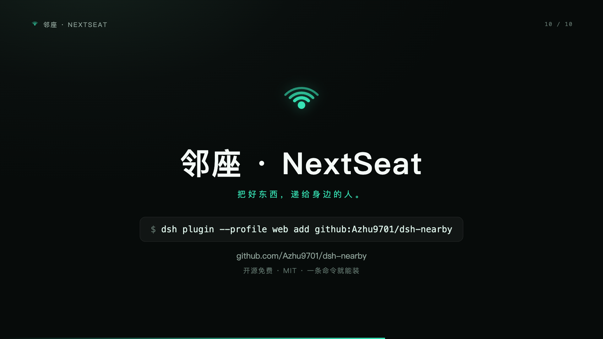
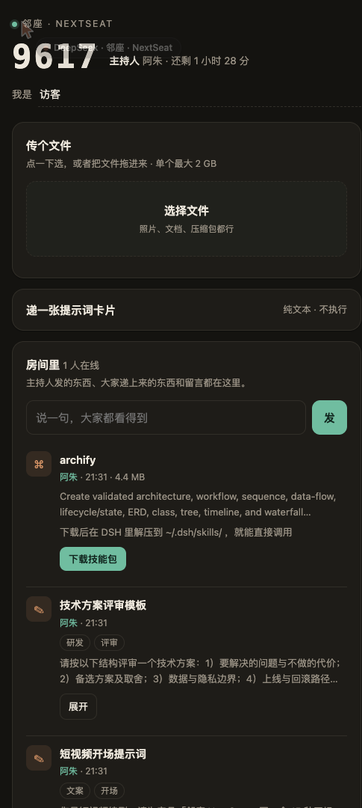
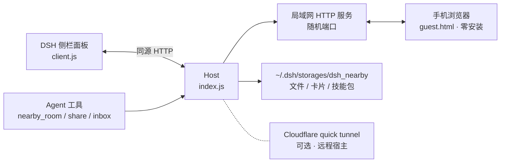

<div align="center">


# 邻座 · NextSeat

**DSH 的面对面分享空间。** 开一间房，把二维码递出去——你刚在 DSH 里做好的文件、提示词、技能包，直接到在场每个人手里。

[](LICENSE)
[](https://github.com/awesome-dsh-plugin/awesome-dsh-plugin)
[](https://github.com/Azhu9701/dsh-nearby/releases)

[中文](README.md) · [English](README.en.md)

</div>



<p align="center"><a href="https://github.com/Azhu9701/dsh-nearby/releases/download/v0.6.0/dsh-nearby-intro.mp4">▶ 看 86 秒介绍视频</a> · <a href="https://github.com/Azhu9701/dsh-nearby/releases">版本说明</a></p>

## 为什么是邻座

在 DSH 里做出来的东西，全都躺在你自己的电脑上。旁边的人说「发我一份」——然后你开始加微信、传网盘、找 U 盘，一次面对面的分享，绕了三个软件。

邻座把这件事缩成一步：**开一间房，把二维码递过去。**

- **对方零安装**：手机浏览器打开就能进，不用装 DSH、不用注册、不用加好友。
- **关房即散**：房间不存在账号和好友关系里，事情办完点关房，端口回收、入口失效。
- **数据不出门**：默认只在局域网内直连，文件落在你自己的机器上，不经过任何第三方服务器。

> 适合：沙龙、课堂、会议、上门交付、展会——任何「人就在旁边」的场合。

## 功能

| 能力 | 说明 |
| --- | --- |
| 一对多房间 | 4 位房间码 + 二维码 + 带 token 的链接；同一 Wi-Fi 下扫码即进 |
| 文件互传 | 单文件最大 2 GiB，大文件按 32 MB 自动分片，SHA-256 校验，流式落盘 |
| 提示词卡片 | 纯 JSON 卡片（标题 / 标签 / 正文 / 作者），只渲染不执行，可一键导入提示词库 |
| 技能包分享 | 本机技能目录打包成 zip 进房间；收到后可一键装进 `~/.dsh/skills`（校验路径穿越与符号链接）|
| 房间留言 | 宿主与访客都能留一句话，像白板一样即时可见 |
| 就近发现 | 同一 Wi-Fi 下开着邻座的实例自动出现在「附近的人」，一键进房，连扫码都省了 |
| 远程宿主 | 人不在现场时挂一条 Cloudflare quick tunnel，现场打开 https 链接即可进入 |
| Agent 工具 | `nearby_room` / `nearby_share` / `nearby_inbox`，模型可以自己开房、递东西、读收件箱 |

## 快速开始

环境要求：DeepSeek Harness（桌面端）、Node.js ≥ 20；宿主与访客在同一 Wi-Fi（远程模式除外）。

```sh
# 安装（需要已安装 DeepSeek Harness）
dsh plugin --profile web add github:Azhu9701/dsh-nearby
```

装好后按提示重载（或点侧栏刷新按钮），侧栏出现「邻座」面板。

1. 点开「邻座」，填一个称呼、选时长，点 **开一间房**。
2. 把二维码或链接递给身边的人，对方用手机浏览器打开。
3. 对方上传文件、递提示词卡片或留言；你在面板里实时看到，点「保存」或「导入提示词库」。
4. 事情办完点 **关房**：端口回收，房间不存在了。

<p align="center">
  
</p>

<p align="center"><sub>手机访客页：扫码即进，无需安装 · 文件 / 提示词 / 技能包 / 留言都在这里</sub></p>


## 工作方式



- **Host**：房间生命周期、路由、文件落盘、技能打包、隧道管理、Agent 工具。
- **访客页**：单文件 `guest.html`，无框架、无构建，手机浏览器直接打开。
- **没有服务器**：默认不依赖任何中心服务；可选隧道只是把本机端口暂时映射到公网。

## Agent 工具

| 工具 | 用途 |
| --- | --- |
| `nearby_room` | 查状态 / 开房 / 关房；`status` 会列出手边谁开着房 |
| `nearby_share` | 往房间递文件、提示词卡片、技能包或留言 |
| `nearby_inbox` | 读房间里的收件（文件、卡片、技能包、留言）|

示例：对 Agent 说「开个房间，把这个技能分享给现场的人」，它会调 `nearby_room` 开房、`nearby_share` 打包技能，并告诉你房间码和链接。

## 安全与隐私

- **私网闸门**：默认只接受私有网段来源（127/10/172.16-31/192.168/169.254/ULA/链路本地），公网 IP 一律拒绝。
- **token 鉴权**：房间使用 32 字节随机 token；宿主侧变更接口还要求自定义请求头，防跨站简单请求。
- **文件名净化**：上传文件名会净化；zip 技能包安装前检查绝对路径、`..` 与符号链接。
- **本地落盘**：数据只落在宿主本机 `~/.dsh/storages/dsh_nearby/`，关房后可自行清理。
- **边界**：局域网内是明文 HTTP，不提供端到端加密，仅适合可信网络；公网模式请勿把链接发到公开群。

## 配置

可选配置文件 `~/.dsh/storages/dsh_nearby/config.json`：

```json
{
  "tunnel": { "kind": "cloudflare", "cloudflared": "/opt/homebrew/bin/cloudflared" },
  "relay": { "sshHost": "", "publicHost": "", "portMin": 39000, "portMax": 39999 }
}
```

- `tunnel.kind`：`cloudflare`（默认，quick tunnel）或 `ssh`（自备 VPS 反向隧道，需要 VPS 放行端口）。
- 环境变量覆盖：`DSH_NEARBY_TUNNEL`、`DSH_NEARBY_RELAY_SSH`、`DSH_NEARBY_RELAY_HOST`、`CLOUDFLARED_BIN`。

## 常见问题

**手机打不开链接？** 先确认手机和电脑在同一个 Wi-Fi，且路由器没有开启 AP 隔离 / 访客网络隔离。可以先用另一台电脑访问面板里显示的 `http://<局域网 IP>:<端口>/` 验证。

**macOS 弹出防火墙提示？** 允许 Node 接受传入连接，否则手机无法访问随机端口。

**开了代理但打不开？** 手机或电脑的系统代理可能把局域网 IP 也代理了；把局域网网段加入 `no_proxy`，或临时关闭代理。

**大文件传一半失败？** 局域网模式单文件上限 2 GiB；公网隧道有单请求大小限制，插件会自动分片，但请保持页面在前台。

**房间关了还能进吗？** 不能。关房后 60 秒内刷新会看到「这个房间已经关了」，之后端口回收、页面无法连接。

## 开发

```sh
node --check index.js
node --check client.js
```

插件结构：`index.js`（Host：路由 / 房间 / 隧道 / Agent 工具）、`client.js`（DSH 侧栏面板）、`guest.html`（手机访客页，零安装）、`cordis.patch.yml`（bundle 挂载）、`vendor/qrcode.cjs`（二维码生成）。

## License

[MIT](LICENSE)
